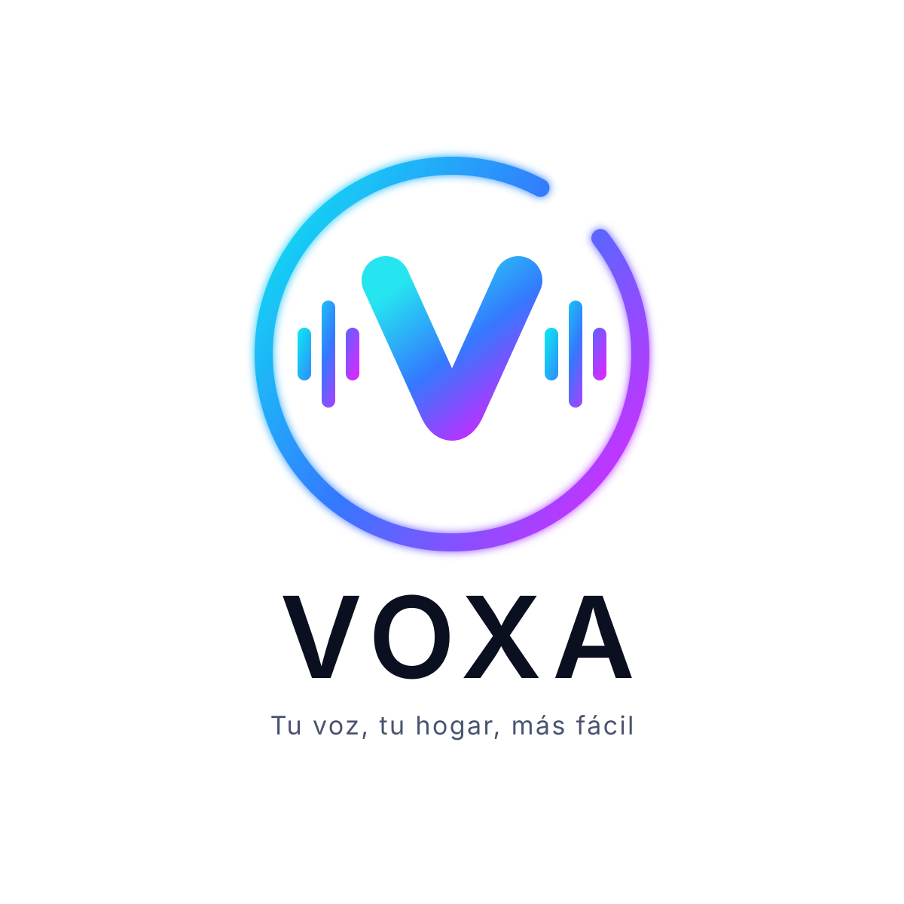

<p align="center"></p>

# VOXA

Asistente de voz familiar para la cocina, sobre una PC All-in-One con Linux Mint: música de Spotify, videos de recetas, temporizadores, volumen, hora y clima, todo por voz y en español.

- **Plan del proyecto:** [docs/voxa_plan.md](docs/voxa_plan.md)
- **Fase 0 (diagnóstico del equipo):** [docs/fase0_guia.md](docs/fase0_guia.md)
- **Marca:** [assets/brand/](assets/brand/)

## Estado

| Parte | Estado |
|---|---|
| NLU en español (gramática, números, duraciones, corrección de errores del STT) | ✅ |
| Temporizadores persistentes con alarma | ✅ |
| Música: Web API + Connect → CLI de Spotifast → MPRIS | ✅ (falta probar en el equipo real) |
| Volumen (PipeWire), hora, clima (Open-Meteo) | ✅ |
| Modo texto (`voxa texto`) | ✅ |
| Voz con «pulsar para hablar» (`voxa voz`): micrófono, fin de frase, STT híbrido Vosk/Whisper, Piper, sonidos, ducking | ✅ (falta calibrar en el equipo real) |
| Pantalla de cocina (`ui/`, Rust + egui): reloj, clima, temporizadores, música, anillo animado, fondos, modo noche, diagnóstico | ✅ (falta probar en el equipo real) |
| Avisos de problemas (sin internet, sin micrófono, Spotifast cerrado…) y micrófono apagable | ✅ |
| Videos de YouTube (yt-dlp + mpv) controlados por voz | ✅ (falta probar en el equipo real) |
| Servicios systemd e instalador | ✅ (falta probar en el equipo real) |
| «Hey Voxa» (detector de palabra de activación) | ⏳ Fase 3 |

## Probarlo (sin micrófono)

```bash
python -m venv .venv
.venv/bin/pip install -e ".[dev]"          # Windows: .venv\Scripts\pip
.venv/bin/voxa texto --simulado            # música y volumen simulados
```

```text
> pon un temporizador de diez minutos para el arroz
VOXA: 10 minutos para el arroz.
> cuánto le falta al arroz
VOXA: Faltan 10 minutos.
> pon Soda Stereo
VOXA: Soda Stereo.
> pon un video de cómo hacer pan de elote
VOXA: Poniendo: Cómo hacer pan de elote.
> pausa
VOXA: [sonido: ok]
```

Mientras hay un video puesto, «pausa», «sigue», «adelanta 30 segundos» y «cierra el video» le hablan al video; al cerrarlo, vuelven a la música. En el equipo real, yt-dlp busca en YouTube y mpv lo reproduce a pantalla completa (720p como máximo, `[video]` en la configuración); encima del video aparecen «Te escucho…» y las respuestas. Tocar la pantalla pausa y dos toques cierran el video.

### Con voz

```bash
.venv/bin/pip install -e ".[audio]"
python -m piper.download_voices es_MX-claude-high --download-dir models/piper
# + modelo de Vosk en español en models/vosk/ (https://alphacephei.com/vosk/models)
export VOXA_CONFIG=config/dev.toml          # PowerShell: $env:VOXA_CONFIG="config/dev.toml"
voxa voz --simulado                         # Enter → hablar
voxa decir "Diez minutos para el arroz."    # probar la voz
voxa sonidos                                # escuchar los sonidos de VOXA
voxa decir --fonemas "Juan Gabriel"         # revisar una pronunciación
voxa escuchar grabacion.wav                 # procesar una grabación
```

`scripts/evaluar_voz.py` mide la cadena voz → intención: Piper «dice» todo el corpus (con ruido opcional) y compara Vosk, Whisper y el híbrido. Con voces sintéticas (más difíciles que una voz real) el híbrido llega a 81 % con Whisper *base* y a 87 % con *small*. La elección final sale del benchmark de la Fase 0 en el equipo real.

Si VOXA pronuncia mal un nombre, agrégalo a `~/.config/voxa/pronunciacion.yaml` (formato en [src/voxa/audio/pronunciacion.yaml](src/voxa/audio/pronunciacion.yaml)).

### Pantalla de cocina

```bash
cd ui && cargo build --release               # requiere Rust (https://rustup.rs)
python scripts/demo_pantalla.py              # datos de ejemplo, sin micrófono ni Spotify
ui/target/release/voxa-ui                    # --completa para pantalla completa
python scripts/descargar_fondos.py           # ~77 fondos: México, pueblos y paisajes de todo el mundo
```

La pantalla se conecta sola a `voxa texto`, `voxa voz` o `voxa servicio` (puerto 8766, solo local) y se reconecta si VOXA se reinicia. Las fotos de `~/.local/share/voxa/fondos/` (también las tuyas) rotan cada 10 minutos (`--cambio-fondo`).

- **Anillo:** tocarlo equivale a pulsar para hablar. Se pone **ámbar** con el problema debajo cuando algo falla («Sin internet», «No encuentro el micrófono», «Spotifast no responde», «Falta conectar Spotify»).
- **Micrófono:** el botón junto al anillo (o decir «deja de escuchar») lo apaga de verdad: VOXA suelta el micrófono. Tocar el anillo lo vuelve a encender.
- **Clima:** con `latitude` y `longitude` en `[weather]`, se ve el clima del momento y el del día.
- **Modo noche:** de 22:00 a 6:30 la pantalla se oscurece (`--noche 23:00-07:00` para cambiarlo, `--sin-noche` para quitarlo). Un toque la enciende 30 s sin activar ningún botón; las alarmas y las respuestas la encienden solas.
- **Diagnóstico:** mantener presionado el reloj muestra versión, voz, micrófono, música, red, problemas y los últimos avisos del registro.

Los fondos ([assets/fondos/catalogo.json](assets/fondos/catalogo.json)) son fotos de Wikimedia Commons en **dominio público o CC0**. El script vuelve a consultar en Commons la licencia de cada una antes de bajarla y, por precaución, omite las importadas de Unsplash que Commons aún no revisa a mano (`--incluir-sin-revisar` las agrega).

Sin `--simulado`, usa Spotify, Spotifast y PipeWire reales. Para configurarlos, ver la [guía de la Fase 0](docs/fase0_guia.md#51-probar-voxa-con-spotify-real-modo-texto).

## Instalar en la PC de la cocina

```bash
git clone <este repositorio> ~/voxa && cd ~/voxa
bash scripts/install.sh --simular     # ver qué hará, sin cambiar nada
bash scripts/install.sh               # paquetes, VOXA, modelos, pantalla, fondos, videos, audio y arranque automático
```

El instalador se puede repetir sin miedo: respeta lo ya instalado y nunca sobrescribe `~/.config/voxa/config.toml`. Deja la bocina Bluetooth fija en alta calidad y sin «dormirse» ([deploy/wireplumber/](deploy/wireplumber/)), VOXA como servicio de usuario (`systemctl --user status voxa`), la pantalla abriéndose al iniciar sesión y yt-dlp actualizándose cada semana (`voxa-ytdlp.timer`), porque YouTube cambia seguido. Si al servicio le faltan los modelos de voz o el micrófono, no se cae: la pantalla lo avisa en ámbar. Queda a mano el inicio de sesión automático y `voxa spotify-login`.

## Pruebas

```bash
.venv/bin/pytest
```

El corpus [tests/data/utterances.yaml](tests/data/utterances.yaml) guarda frases reales con su intención esperada. Cada frase que VOXA no entienda debe agregarse ahí antes de corregir la gramática ([src/voxa/nlu/grammar.yaml](src/voxa/nlu/grammar.yaml)).

## Estructura

```text
src/voxa/
├── nlu/        normalización, números/duraciones, grammar.yaml, matcher
├── core/       asistente (enrutamiento), tipos, frases en español
├── skills/     música, video, volumen, temporizadores, hora, clima, sistema
├── services/   Spotify (Web API, auth PKCE), Spotifast CLI, MPRIS, PipeWire, Open-Meteo, yt-dlp + mpv
├── state/      temporizadores persistentes
├── display.py  estado para la pantalla y su canal local
├── health.py   problemas que la pantalla avisa en ámbar
├── diagnostics.py  reporte de la pantalla de diagnóstico
├── service.py  voz + pantalla + temporizadores + video juntos
├── app.py      arma todo
└── main.py     CLI: voxa texto | voz | servicio | decir | spotify-login
ui/             voxa-ui: pantalla de cocina (Rust + egui)
scripts/fase0/  diagnóstico y benchmarks para correr en la PC
config/         configuración de ejemplo
```
