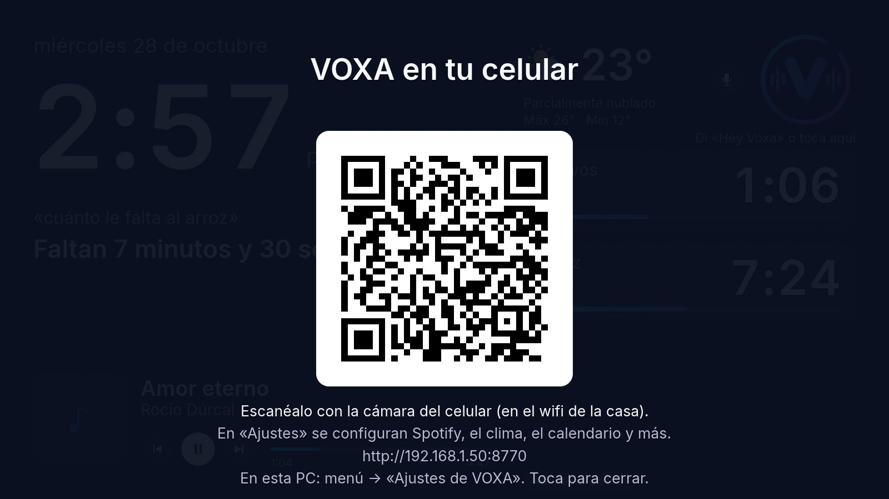
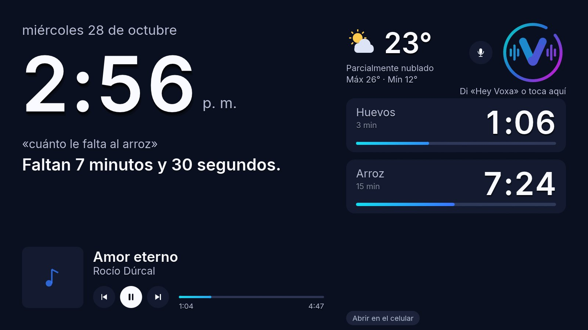
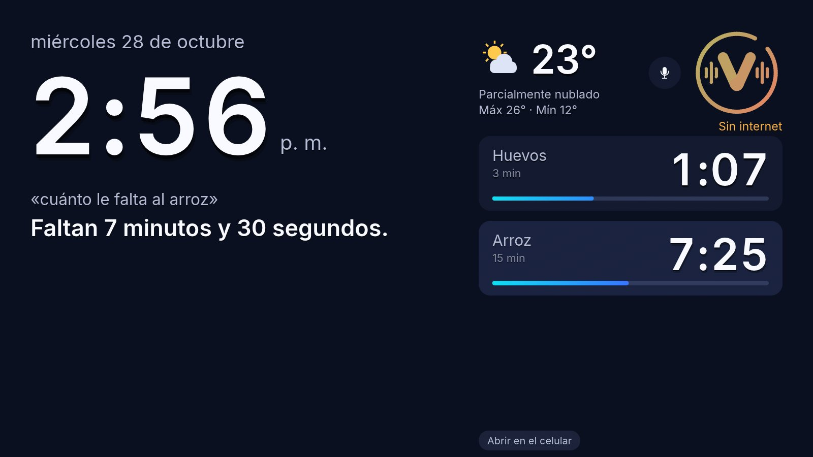
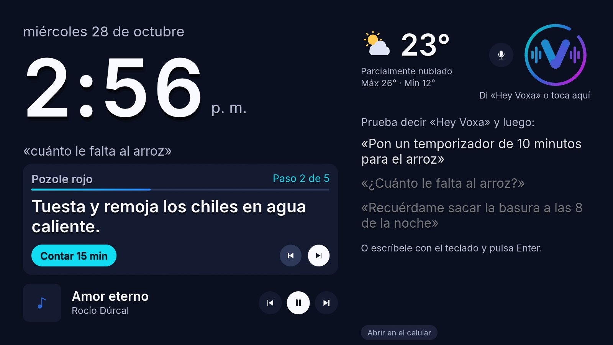
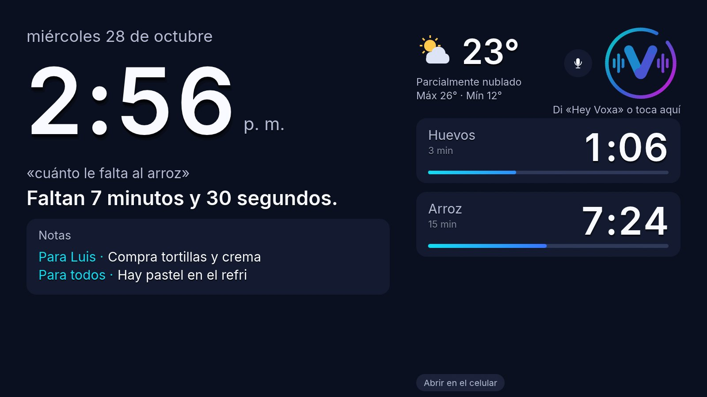
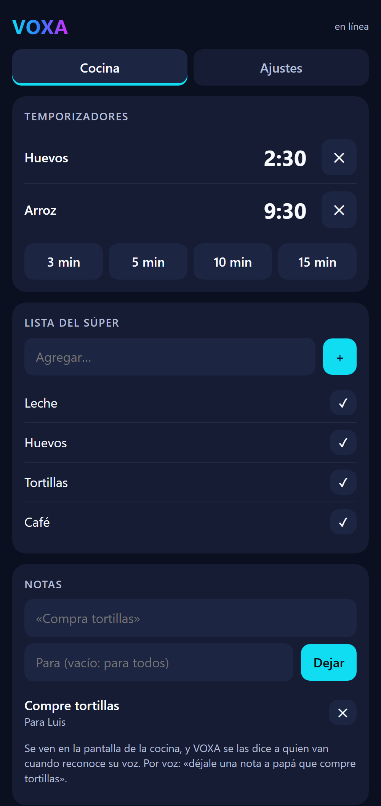
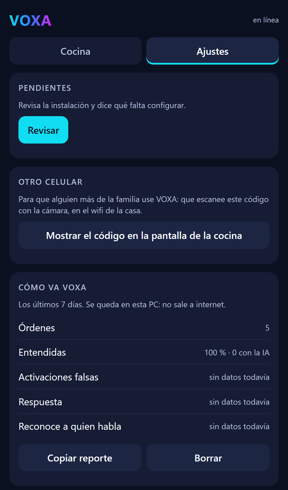
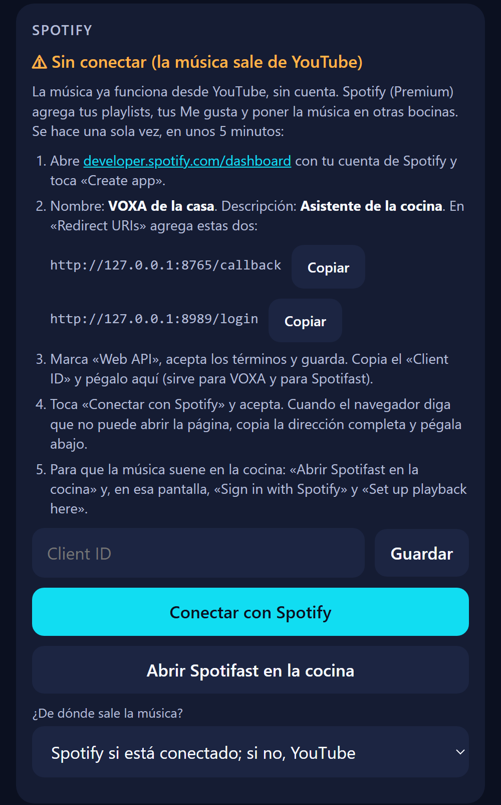
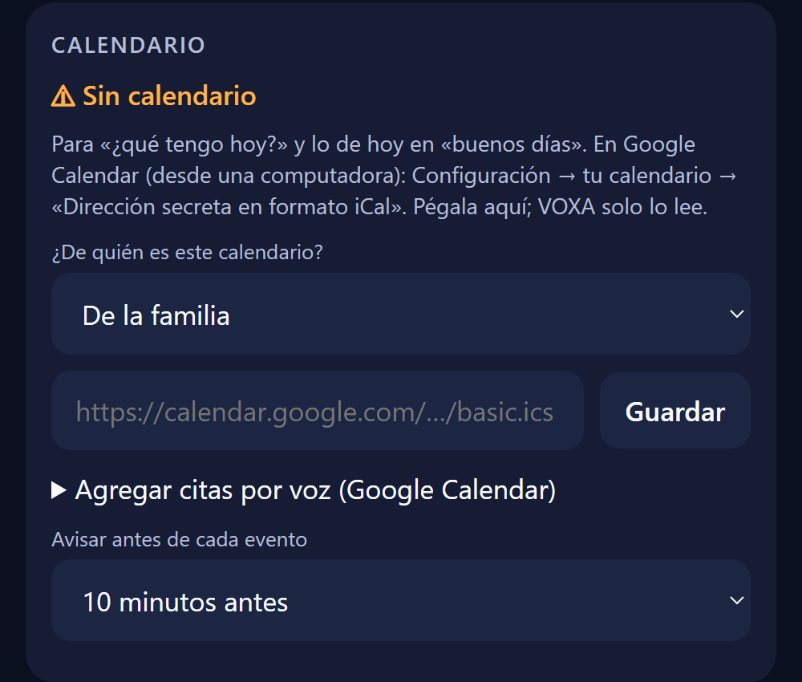
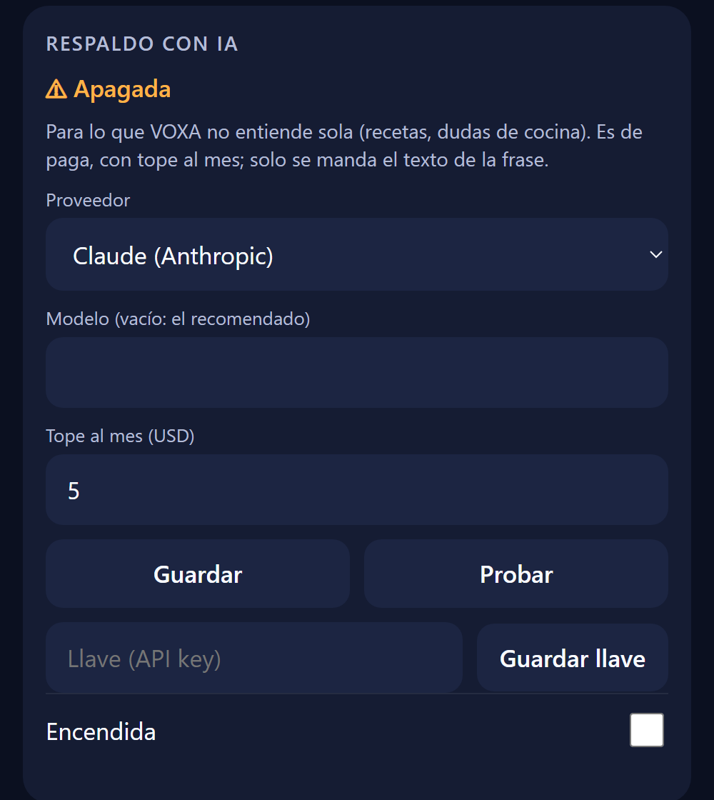

# Manual de VOXA

VOXA es el asistente de voz de la cocina. Pone música y videos de recetas, cuenta tiempos, recuerda cosas, lleva la lista del súper, convierte medidas, dice la hora y el clima, y mucho más. Todo se hace hablando, y lo que no se dice se ajusta desde el celular o desde la misma PC.

Este manual es para la familia: no hace falta saber de computadoras. Lo de la terminal va al final, para quien lo quiera.

**Contenido**

1. [Instalar VOXA](#1-instalar-voxa)
2. [La primera vez](#2-la-primera-vez)
3. [Cómo hablarle](#3-cómo-hablarle)
4. [La pantalla de la cocina](#4-la-pantalla-de-la-cocina)
5. [Qué le puedes pedir](#5-qué-le-puedes-pedir)
6. [VOXA en el celular y en la PC](#6-voxa-en-el-celular-y-en-la-pc)
7. [Ajustes, sección por sección](#7-ajustes-sección-por-sección)
8. [Cuentas y llaves: Spotify, Google, Telegram, IA](#8-cuentas-y-llaves)
9. [VOXA en varios cuartos](#9-voxa-en-varios-cuartos)
10. [Privacidad](#10-privacidad)
11. [Actualizaciones](#11-actualizaciones)
12. [Si algo no funciona](#12-si-algo-no-funciona)
13. [Para quien usa la terminal](#13-para-quien-usa-la-terminal)

---

## 1. Instalar VOXA

### En la PC de la cocina (Linux Mint o Ubuntu)

1. Entra a la página de versiones: <https://github.com/luis314159/voxa/releases/latest>.
2. Baja **`voxa_X.Y.Z_amd64.deb`** (X.Y.Z es el número de la versión).
3. Ábrelo con doble clic y toca **«Instalar paquete»**. Pide tu contraseña una vez.
4. Cierra la sesión y vuelve a entrar (menú → apagar → «Cerrar sesión»). No hace falta reiniciar la PC.

> **Si sale «Failed to download package files» con errores 404:** la lista de programas de la PC está vieja. Abre el **Gestor de actualizaciones**, toca **«Actualizar»**, instala lo que salga y vuelve a abrir el `.deb`.

### En una Raspberry Pi 4 o 5 (sin instalar nada)

Cada versión trae una imagen de Raspberry Pi OS con VOXA ya puesta. Necesitas una tarjeta microSD de **16 GB o más**.

1. Instala **Raspberry Pi Imager** en tu computadora.
2. En las opciones de Imager, en «Contenido» (*content repository*), pega:
   `https://github.com/luis314159/voxa/releases/latest/download/os_list_voxa.json`
3. Elige **VOXA** como sistema operativo y tu tarjeta.
4. Antes de grabar, Imager te deja poner el **wifi de la casa**, el usuario y el nombre del equipo (por ejemplo `sala`).
5. Pon la tarjeta en la Raspberry Pi y enciéndela.

---

## 2. La primera vez

1. **VOXA baja sus voces.** Al entrar a la sesión se abre la pantalla de la cocina y dice «Preparando VOXA». Baja los modelos de voz (unos minutos, según el internet).
2. **Aparece un código QR.** Escanéalo con la cámara del celular, **conectado al wifi de la casa**. Se abre la página de VOXA.

   

3. **Configura lo básico en «Ajustes»:**
   - **Clima:** escribe tu ciudad y elígela.
   - **Voz de la familia:** que cada quien grabe su voz (sección 7).
   - Lo demás (Spotify, calendario, IA…) es opcional.
4. **Guarda la página en el celular:** en el menú del navegador, «Agregar a la pantalla de inicio». Así queda como un ícono y no necesitas el QR otra vez.

**¿Se te fue el código QR?** Vuelve a sacarlo de cualquiera de estas formas:

- Toca **«Abrir en el celular»**, abajo en la pantalla de la cocina.
- Di **«Hey Voxa, conecta mi celular»**.
- Desde un celular que ya está conectado: Ajustes → **«Otro celular»** muestra el código ahí mismo.
- En la PC: menú → **«Ajustes de VOXA»** abre la página en el navegador, sin código.

**Raspberry Pi sin pantalla:** di «Hey Voxa, conecta mi celular». VOXA te dice en voz alta qué dirección abrir (`voxa.local:8770`) y un código de 6 dígitos para entrar.

---

## 3. Cómo hablarle

Hay cuatro formas, y todas hacen lo mismo:

| Forma | Cómo |
|---|---|
| **Con la voz** | Di **«Hey Voxa»** (u «Oye Voxa») y la orden, de corrido: «Hey Voxa, pon un temporizador de 10 minutos». |
| **Tocando la pantalla** | Toca el **anillo** (el círculo con la V) y habla. |
| **Con el teclado** | En la pantalla de la cocina, **empieza a escribir**. Aparece un renglón: **Enter** lo manda y **Esc** lo cancela. No hace falta el mouse. Sirve si el micrófono falla. |
| **Desde el celular** | En la pestaña «Cocina», sección **«Escríbele a VOXA»**. Por defecto contesta en el celular sin hablar en la cocina; marca «Que lo diga en voz alta» si quieres que se oiga. |

Consejos:

- **Mientras suena una alarma** basta con decir «ya», «para» o «gracias», sin «Hey Voxa».
- **Para que VOXA no se active con la tele** y sepa quién le habla, que cada quien grabe su voz (Ajustes → Voz de la familia).
- **Para pedir otra cosa sin repetir «Hey Voxa»:** Ajustes → Accesibilidad → «seguir escuchando» unos segundos después de contestar.
- Si no te entendió, **«repite»** o «¿qué dijiste?» repite su última respuesta.

---

## 4. La pantalla de la cocina



- **El anillo:** tócalo para hablar. Cambia de color cuando escucha, piensa o habla. Se pone **ámbar** cuando algo falla, con el problema escrito debajo («Sin internet», «No encuentro el micrófono»…).
- **El micrófono** (botón junto al anillo): lo apaga de verdad; VOXA deja de escuchar. También con «Hey Voxa, deja de escuchar». Tocar el anillo lo vuelve a encender.
- **«Abrir en el celular»** (abajo): muestra el código QR.
- **Temporizadores:** cada uno con su cuenta. Tócalo para que aparezca la **×** y cancelarlo.
- **Música:** canción, portada y botones de anterior, pausa y siguiente.
- **Modo foto:** dos toques en una parte vacía (o «modo foto») dejan solo la imagen de fondo. Un toque la regresa.
- **Modo noche:** de 10 de la noche a 6:30 de la mañana la pantalla se oscurece. Un toque la enciende 30 segundos; las alarmas y respuestas también.
- **Diagnóstico:** **mantén presionado el reloj**. Muestra la versión, el micrófono, la música, la red, los problemas y el gasto de la IA del mes.
- **«IA»** arriba del micrófono: aparece mientras el respaldo con IA (de paga) está encendido.
- **Fondos:** fotos de paisajes que cambian cada 10 minutos. Puedes subir fotos de la familia desde el celular.



**Abrir la pantalla otra vez:** si la cerraste, en el menú de la PC busca **«VOXA»**.

---

## 5. Qué le puedes pedir

Pregúntale **«¿qué puedes hacer?»** y te da ideas. Estos son ejemplos; hay muchas formas de decir lo mismo.

### Temporizadores, alarmas y recordatorios

- «Pon un temporizador de 10 minutos para el arroz»
- «¿Cuánto le falta al arroz?» · «Agrégale 5 minutos» · «Pausa el temporizador» · «Cancela el del arroz» · «Cancela todos los temporizadores»
- Cuando suena: «ya» para apagarla, o «5 minutos más»
- «Recuérdame sacar la basura a las 8 de la noche»
- «Despiértame de lunes a viernes a las 6» · «Recuérdame regar las plantas los martes a las 7»
- «Recuérdale a Luis que saque la basura a las 9»

### Música

- «Pon a Juan Gabriel» · «Pon Amor eterno» · «Pon algo tranquilo para cocinar» · «Pon salsa» · «Pon música de los 80»
- «Pausa» · «Sigue» · «Siguiente» · «Anterior» · «Modo aleatorio»
- «¿Qué canción es esta?»
- Con Spotify: «Pon mis me gusta» · «Pon mi playlist para correr» · «¿Qué playlists tengo?» · «Me gusta esta canción» · «Pásala a la sala»

Sin cuenta, la música sale de **YouTube** (gratis). Con **Spotify Premium** se agregan tus playlists y tus Me gusta (sección 8).

### Volumen

- «Súbele» · «Bájale un poco» · «Pon el volumen en 40» · «Silencia» · «Quita el silencio»

### Videos de recetas (YouTube)

- «Pon un video de cómo hacer pozole»
- Mientras se ve: «pausa», «sigue», «adelanta 30 segundos», «regrésale 10 segundos», «cierra el video»
- En la pantalla: un toque pausa, dos toques lo cierran.

### Recetas paso a paso (con la IA)

- «Dame la receta de pozole» · «Cómo se hace el arroz rojo»
- «¿Qué ingredientes lleva?» · «Siguiente paso» · «Paso anterior» · «Repite el paso» · «Ve al paso 4»
- «Pon el tiempo» (cuenta los minutos de ese paso) · «Agrega los ingredientes a la lista» · «Termina la receta»

Sin IA, «receta de pozole» pone un video.



### Cocina

- «¿Cuántos gramos es una taza de harina?» · «¿Cuántas cucharadas son media taza?»
- «350 grados Fahrenheit en centígrados»

### Lista del súper

- «Se acabó el café» · «Agrega leche y tortillas a la lista»
- «¿Qué hay en la lista?» · «Quita la leche de la lista» · «Borra la lista»

### Notas y recados

- «Déjale una nota a papá que compre tortillas» · «Pon una nota que diga no hay agua caliente»
- «¿Tengo recados?» · «Ya leí mis recados»

VOXA le dice la nota a esa persona la próxima vez que reconoce su voz. Las notas se ven en la pantalla y se borran solas a los 3 días.



### Pendientes de cada quien

- «Agrega llamar al plomero a mis pendientes» · «¿Qué pendientes tengo?» · «Ya hice la tarea de mate»
- «Agrega la tarea de mate a los pendientes de Luis» · «¿Qué pendientes tiene Ana?»

### Medicinas

- «Recuérdale a Ana que se tome la pastilla de la presión a las 8»
- Cuando pregunta «¿ya te la tomaste?»: «ya me la tomé» o «todavía no» (sin «Hey Voxa»)
- «¿Ya se tomó Ana la medicina?»

### Calendario

- «¿Qué tengo hoy?» · «¿Qué tengo mañana?» · «¿Cuál es mi siguiente cita?» · «¿Qué tiene Ana hoy?»
- Con Google conectado: «Agrega dentista el martes a las 5 al calendario» · «Agenda el cumpleaños de Ana el sábado»

### El día

- «¿Qué hora es?» · «¿Qué día es hoy?»
- «¿Cómo está el clima?» · «¿Va a llover hoy?»
- **«Buenos días»:** saluda por nombre y dice la hora, el clima, los recordatorios, el calendario, tus pendientes y cuánto falta para salir.
- «Buenas noches» · «¿Cuánto falta para salir?»

### La casa

- «Avisa a todos que ya está la comida» · «Dile a la sala que se bajen a cenar» (con VOXA en varios cuartos)
- «Modo niños» (sección 7)
- «Aprende mi voz» (graba tu voz, guiado)
- «Conecta mi celular» · «Modo foto» · «Deja de escuchar»
- «¿Hay actualizaciones?» · «Actualízate»

### En inglés

En Ajustes → Funciones se cambia el idioma a inglés, o se enciende **«Casa bilingüe»**: entiende los dos idiomas y contesta cada frase en el idioma en que se dijo («what's the weather like?»).

---

## 6. VOXA en el celular y en la PC

Es **la misma página** en los dos lados y se configura lo mismo:

- **En el celular:** escanea el código QR (sección 2).
- **En la PC de la cocina:** menú → **«Ajustes de VOXA»**. Se abre en el navegador.

La página funciona solo **en el wifi de la casa** y con la clave que lleva el código QR. Nadie más en la red puede entrar sin ella.

Tiene dos pestañas.

### Pestaña «Cocina»

- **Sonando:** la música, con sus botones.
- **Temporizadores:** verlos, cancelarlos y poner temporizadores rápidos.
- **Lista del súper:** agregar y tachar.
- **Notas:** dejar y borrar recados.
- **Medicinas de hoy:** cuáles se tomaron, y un botón para marcar la que se tomó sin avisar.
- **Pendientes:** de cada persona, para tacharlos.
- **Playlists:** las de tu cuenta de Spotify, o buscar otras y ponerlas con un toque.
- **Casa:** mandar un aviso a los otros cuartos.
- **Escríbele a VOXA:** escribir una orden.
- **Fondo de pantalla:** subir fotos de la familia.



### Pestaña «Ajustes»

Todo lo de la sección 7.



---

## 7. Ajustes, sección por sección

Al guardar, VOXA se reinicia sola si hace falta.

- **Pendientes:** toca «Revisar» y te dice qué falta configurar en la instalación.
- **Otro celular:** el código QR para que alguien más de la familia entre desde su celular. También tiene un botón para mostrarlo en grande en la pantalla de la cocina.
- **Cómo va VOXA:** cuántas órdenes entendió y cuáles no, en los últimos 7 días, y cuántas veces se activó sin que nadie le hablara. «Copiar reporte» sirve para mandárselo a quien la mantiene.
- **Voz de la familia:**
  - Escribe tu nombre, toca **«Grabar»** y ve a la cocina. VOXA te guía en voz alta, como un minuto.
  - Así te reconoce, te saluda por nombre, usa tu Spotify y tu calendario, y no se activa con la tele.
  - Ahí mismo se escriben los **apodos** («papá», «la abuela») para que los recados lleguen a la persona correcta.
- **Spotify:** ver la sección 8.
- **Clima:** busca tu ciudad.
- **Calendario:** ver la sección 8. También se elige si avisa antes de cada evento: 5, 10, 15 o 30 minutos, o no avisar.
- **Lista del súper en Telegram:** ver la sección 8.
- **Respaldo con IA:** ver la sección 8.
- **Cuartos:** agregar VOXA en otros cuartos (sección 9).
- **Rutina de la mañana:**
  - Hora de salida y días de escuela.
  - Lo que no hay que olvidar («mochila, lonche, uniforme»).
  - Una música para «buenos días» (opcional).
  - VOXA avisa 15 y 5 minutos antes de salir, y a la hora.
- **Privacidad:** qué se queda en la PC y qué sale a internet (sección 10).
- **Accesibilidad:**
  - **Velocidad de la voz** para todos, y aún más despacio con quien lo necesite (por ejemplo, los abuelos).
  - **Letra grande** en la pantalla.
  - **Seguir escuchando** 4, 6 o 10 segundos después de contestar.
- **Medicinas:**
  - Preguntar «¿ya te la tomaste?» y cada cuánto.
  - Después de cuántas preguntas sin respuesta avisa a otra persona, por Telegram o en los otros cuartos.
- **Horas de silencio:** por ejemplo de 22:00 a 7:00. VOXA habla bajito y no avisa en otros cuartos. Las alarmas suenan normal.
- **Modo niños:**
  - Marca quiénes son niños (deben haber grabado su voz).
  - Música sin canciones explícitas (con Spotify), volumen máximo, horario para videos y respuestas de la IA para niños.
  - «Para todos» lo aplica a cualquiera, por ejemplo con visitas.
  - Por voz se enciende con «Hey Voxa, modo niños». **Se apaga solo desde aquí**, para que los niños no lo quiten.
- **Funciones:**
  - Videos de YouTube.
  - Avisar si hay versión nueva y actualizarse sola de madrugada.
  - Idioma (español o inglés) y casa bilingüe.
  - **Reconocimiento de voz:** rápido, normal o preciso. Preciso entiende mejor, pero tarda más en contestar.

---

## 8. Cuentas y llaves

Todo se conecta en **Ajustes**, desde el celular o desde la PC. Las llaves se guardan solo en la PC de la cocina y nunca se vuelven a mostrar.

> **Cuando Spotify o Google digan que «no se puede abrir la página», es normal.** Copia la dirección completa de la barra del navegador y pégala en la página de VOXA, en el campo que aparece.

### Spotify (la cuenta de la casa)

Necesitas **Spotify Premium**. Es un trámite de una sola vez, de unos 5 minutos, porque Spotify pide una «app de desarrollador»:

1. Abre **developer.spotify.com/dashboard** con tu cuenta y toca **«Create app»**.
2. Nombre: «VOXA de la casa». Descripción: «Asistente de la cocina».
3. En **«Redirect URIs»** agrega las dos direcciones que muestra VOXA (tienen botón «Copiar»).
4. Marca **«Web API»**, acepta los términos y guarda.
5. Copia el **«Client ID»** y pégalo en VOXA. Toca «Guardar».
6. Toca **«Conectar con Spotify»** y acepta. Pega la dirección de regreso.
7. Toca **«Abrir Spotifast en la cocina»**. En la pantalla de la cocina toca «Sign in with Spotify» y «Set up playback here». Así la música suena en la bocina de la cocina.

Ahí mismo se elige de dónde sale la música: Spotify si está conectado (y si no, YouTube), solo Spotify o solo YouTube.



### Spotify de cada quien

En Ajustes → Spotify → **«La cuenta de cada quien»**, cada persona conecta la suya. Cuando VOXA reconoce su voz, «pon mis me gusta» y «pon mi playlist…» usan su cuenta (también sus playlists privadas). La música sigue sonando en la cocina.

Spotify deja **hasta 5 cuentas**. El correo de cada persona se agrega antes en tu app de Spotify, en **«User Management»**.

### Calendario (para leerlo)

Para «¿qué tengo hoy?» y los avisos antes de cada evento:

1. En **Google Calendar desde una computadora:** Configuración → tu calendario → **«Dirección secreta en formato iCal»**. También sirve la de iCloud u Outlook.
2. Pégala en Ajustes → Calendario y elige de quién es: de la familia o de una persona.

Solo lee: no puede cambiar nada de tu calendario.



### Google Calendar (para agregar citas por voz)

Para decir «agrega dentista el martes a las 5 al calendario». Es una vez, de unos 10 minutos, desde una computadora:

1. En **console.cloud.google.com** crea un proyecto («VOXA de la casa») y activa la **«Google Calendar API»**.
2. En **«Pantalla de consentimiento de OAuth»** elige el tipo «Externo» y pon tu correo.
   - Al final toca **«Publicar app»** para dejarla en producción.
   - **Importante:** si se queda «En prueba», Google corta el permiso cada 7 días.
3. En «Credenciales» → «Crear credenciales» → **«ID de cliente de OAuth»** → tipo **«App de escritorio»**. Copia el ID y el secreto en VOXA.
4. Toca **«Conectar Google Calendar»**.
   - Google avisa que la app no está verificada: es la tuya. Toca «Configuración avanzada» → «Ir a VOXA».
   - Pega la dirección de regreso.

### Telegram (la lista del súper desde la calle)

1. En Telegram, háblale a **@BotFather**, manda `/newbot` y copia el **token** que te da.
2. Pégalo en Ajustes → Lista del súper en Telegram.
3. Toca **«Vincular un chat»**. Manda al bot el código de 6 dígitos desde tu chat o desde el grupo de la familia.

Al bot se le escribe «leche, huevos y tortillas» o «quita la leche». `/lista` manda la lista con botones para ir palomeando en la tienda.

### Respaldo con IA (Claude, Azure OpenAI u OpenAI)

Para lo que VOXA no entiende sola: recetas paso a paso, dudas de cocina, órdenes dichas de forma rara. **Es de paga**, con un tope al mes. Solo se manda el texto de la frase, nunca audio.

1. Consigue tu llave (API key):
   - **Claude:** en console.anthropic.com → API Keys.
   - **OpenAI:** en platform.openai.com → API keys.
   - **Azure OpenAI:** en el portal de Azure, en tu recurso de Azure OpenAI → «Claves y punto de conexión». Necesitas también el **nombre de tu deployment**.
2. En Ajustes → **Respaldo con IA**, elige el **Proveedor**.
3. **Modelo:** déjalo vacío para usar el recomendado. Con **Azure**, aquí va el nombre de tu deployment.
4. **Dirección del servicio** (solo con Azure): `https://TU-RECURSO.openai.azure.com`.
5. **Tope al mes (USD):** lo máximo que puede gastar.
6. Pega la llave en **«Llave (API key)»** y toca **«Guardar llave»**.
7. Enciende **«Encendida»**, toca «Guardar» y luego **«Probar»**. Hace una pregunta de prueba y dice cuánto costó.



El gasto del mes se ve en el diagnóstico de la pantalla (mantén presionado el reloj).

---

## 9. VOXA en varios cuartos

La cocina es la VOXA principal. La sala, el comedor o las recámaras pueden tener la suya: otra PC o una Raspberry Pi con micrófono y bocina (la pantalla es opcional).

1. Instala VOXA en ese equipo (sección 1).
2. En la VOXA de la cocina: Ajustes → **Cuartos** → escribe el nombre («Sala») → **«Agregar»**. Te da una dirección.
3. En la VOXA nueva: Ajustes → Cuartos → pega esa dirección y el nombre del cuarto.

Cada cuarto tiene su «Hey Voxa», sus temporizadores y su música. La **lista del súper** y el **calendario** son los de la cocina.

«Avisa a todos que ya está la comida» se oye en todos los cuartos. Si una alarma suena 45 segundos sin que nadie la apague, se avisa en los demás.

---

## 10. Privacidad

En Ajustes → **Privacidad** está explicado en palabras sencillas, según lo que tienes encendido.

- **Se queda en la PC:**
  - Lo que dices: se reconoce ahí mismo y no se guarda.
  - Las voces grabadas de la familia.
  - Las listas, notas, medicinas, pendientes y las llaves.
- **Sale a internet, solo si lo usas:**
  - El texto de lo que VOXA no entiende sola, a la IA.
  - Spotify y YouTube.
  - El clima, que solo usa la ciudad.
  - El calendario y Telegram.
  - Las actualizaciones.

---

## 11. Actualizaciones

- VOXA **se actualiza sola de madrugada** cuando la cocina está quieta (Ajustes → Funciones).
- **«Hey Voxa, ¿hay actualizaciones?»** te dice si hay versión nueva, y **«actualízate»** la instala al momento.
- Después de actualizar, si aparecen cosas nuevas en el menú de la PC, cierra la sesión y vuelve a entrar.

---

## 12. Si algo no funciona

Lo primero: toca **«Revisar»** en Ajustes → Pendientes. Dice qué falta y cómo arreglarlo.

**No me oye o se activa poco**

- En la PC: menú → **Sonido** → **Entrada**.
  - Elige el micrófono correcto.
  - Habla: la barra de nivel se debe mover.
  - Deja el volumen de entrada cerca de **70 %**.
- Mientras tanto, **escríbele con el teclado** en la pantalla de la cocina.
- Que cada quien grabe su voz (Ajustes → Voz de la familia).

**Mi voz se oye rota o distorsionada al grabar**

El micrófono está demasiado alto:

1. Baja la entrada a 70 % en Sonido → Entrada.
2. Si sigue igual, en la terminal abre `alsamixer`, presiona **F6** y elige tu tarjeta de sonido, luego **F4**, y baja **«Mic Boost»** a 0.

**Se activa sola con la tele**

Graben su voz en Ajustes → Voz de la familia. VOXA aprende a distinguir a la familia.

**No suena la música en la bocina**

- Revisa que la bocina Bluetooth esté conectada y elegida como salida en **Sonido → Salida**.
- Con Spotify: Ajustes → Spotify → «Abrir Spotifast en la cocina» y «Set up playback here».

**El anillo está ámbar**

Debajo dice el problema. Los más comunes:

- **«Sin internet»:** revisa el wifi.
- **«No encuentro el micrófono»:** revisa que esté conectado y elegido en Sonido → Entrada.
- **«Falta conectar Spotify»:** termina los pasos de Ajustes → Spotify (sección 8).
- **«Spotifast no responde»:** en Ajustes → Spotify toca «Abrir Spotifast en la cocina».

**Perdí el código QR**

Toca «Abrir en el celular» en la pantalla, o di «Hey Voxa, conecta mi celular» (sección 2).

**Cerré la pantalla de la cocina**

Menú de la PC → **«VOXA»**.

**El celular no abre la página**

El celular debe estar en el **wifi de la casa**, no en datos.

**Google Calendar dejó de funcionar a la semana**

La app de Google se quedó «En prueba». Publícala (sección 8, paso 2) y vuelve a conectar.

**Al instalar sale «Failed to download package files»**

Ver la sección 1: actualiza la lista de programas y vuelve a abrir el `.deb`.

**Si nada de esto funciona**, copia el reporte de Ajustes → **Cómo va VOXA** y el resultado de `voxa revisar` (sección 13), y mándaselos a quien mantiene VOXA.

---

## 13. Para quien usa la terminal

```bash
voxa revisar               # revisa la instalación y dice cómo arreglar lo que falte
voxa ajustes               # abre los Ajustes en el navegador de esta PC
voxa celular               # la dirección para el celular (y el QR en la pantalla y en la terminal)
voxa probar-activacion     # nivel del micrófono y qué tan bien oye «Hey Voxa» (Ctrl+C para salir)
voxa como-va               # el reporte de uso de los últimos 7 días
voxa actualizar            # instala la versión más reciente
voxa texto                 # escribirle a VOXA desde la terminal

systemctl --user restart voxa          # reinicia VOXA
journalctl --user -u voxa -n 50        # lo último que pasó (para reportar un problema)
```

Probar el micrófono con buena calidad (graba 5 segundos y los repite):

```bash
arecord -f S16_LE -r 16000 -d 5 prueba.wav && aplay prueba.wav
```

Los detalles técnicos (instalar desde el código, configuración avanzada en `~/.config/voxa/config.toml`) están en el [README](../README.md).
